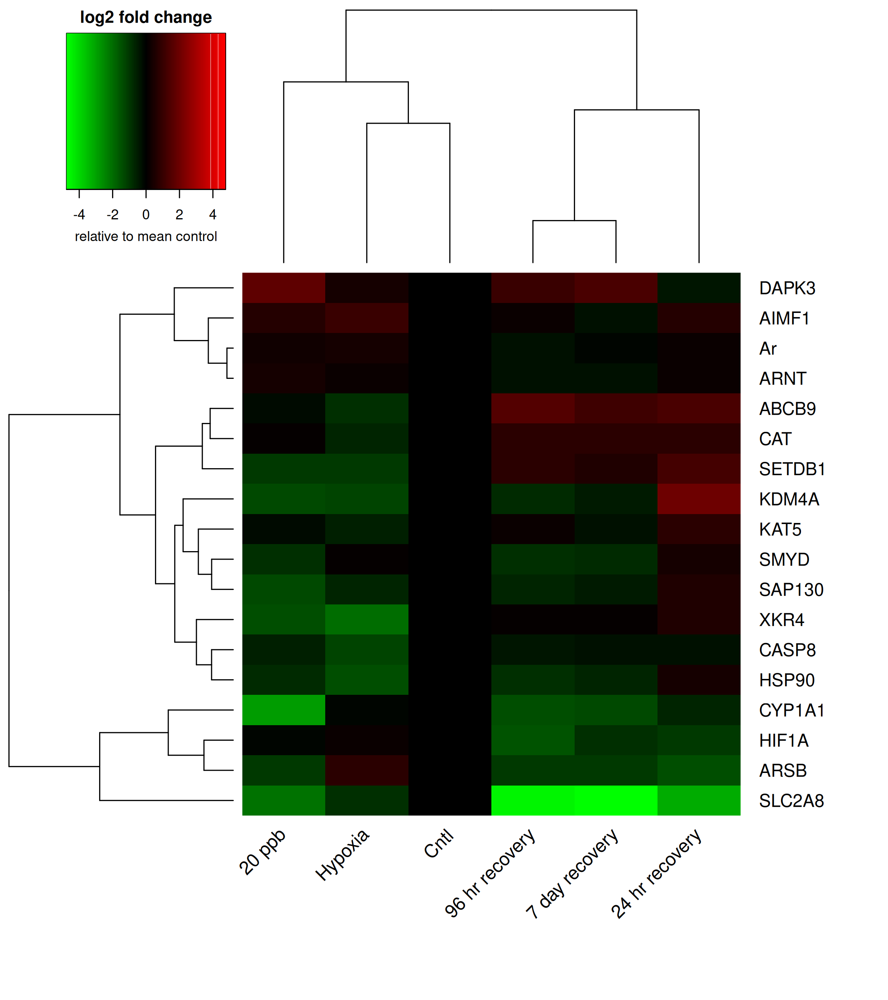

```{r}
library(readxl)
library(tidyr)
library(dplyr)
library(knitr)
library(gplots)
```

```{r}
data.file="qPCR data for heatmap for Kirt 10-30-26.xlsx"

# Keep the names as supplied so duplicated gene columns can be identified.
antho=as.data.frame(
  read_excel(data.file,sheet=1,.name_repair="minimal"),
  check.names=FALSE
)
names(antho)[1]="treatment"
```

The updated workbook contains 19 gene columns, but KDM4A occurs twice and the
two columns contain identical values. KDM4A was included in both the hypoxia
and chromatin-remodeling plots in the workbook. The duplicate is removed here
so that KDM4A does not receive twice the weight of every other gene during
clustering.

```{r}
duplicate.columns=which(duplicated(names(antho)))

for (i in duplicate.columns){
  original.column=which(names(antho)[seq_len(i-1)]==names(antho)[i])[1]
  if (!isTRUE(all.equal(antho[[i]],antho[[original.column]],
                        check.attributes=FALSE))){
    stop("Duplicated gene names contain different data; check the workbook.")
  }
}

duplicate.genes=names(antho)[duplicate.columns]
antho=antho[,-duplicate.columns,drop=FALSE]

data.frame(
  gene.columns.in.workbook=ncol(antho)-1+length(duplicate.columns),
  unique.genes.used=ncol(antho)-1,
  exact.duplicate.removed=paste(duplicate.genes,collapse=", ")
) %>% kable(caption="Data checks for the updated workbook")
```

The three rows for each treatment are the reported mean, minimum, and maximum,
in that order. They are retained as summaries rather than treated as three
independent biological replicates.

```{r}
treatment.levels=c("CNTL","20 ppb","24hr","96hr","7 day","Hypox")
treatment.labels=c(
  "CNTL"="Cntl",
  "20 ppb"="20 ppb",
  "24hr"="24 hr recovery",
  "96hr"="96 hr recovery",
  "7 day"="7 day recovery",
  "Hypox"="Hypoxia"
)

antho$treatment=trimws(antho$treatment)
if (!all(table(antho$treatment)==3)){
  stop("Each treatment must have exactly three summary rows.")
}
if (!setequal(unique(antho$treatment),treatment.levels)){
  stop("The treatment names in the workbook have changed.")
}

antho$treatment=factor(antho$treatment,levels=treatment.levels)
antho$summary.type=rep(c("mean","minimum","maximum"),
                       times=nrow(antho)/3)
```

Converting data to long format

```{r}
antho.long=antho %>%
  pivot_longer(
    cols=-c(treatment,summary.type),
    names_to="Gene.ID",
    values_to="expression"
  )

# Confirm the stated row order before using the mean values.
summary.check=antho.long %>%
  select(treatment,Gene.ID,summary.type,expression) %>%
  pivot_wider(names_from=summary.type,values_from=expression)

if (any(summary.check$minimum>summary.check$mean |
        summary.check$mean>summary.check$maximum,na.rm=TRUE)){
  stop("At least one mean does not fall between its reported minimum and maximum.")
}
```

# Plots
## Heatmap

First, I am creating a summary of gene expression by treatment for the heatmap.

```{r}
treatment.means=antho.long %>%
  filter(summary.type=="mean") %>%
  select(Gene.ID,treatment,expression)

antho.wide=treatment.means %>%
  pivot_wider(names_from=treatment,values_from=expression)

antho.sum=as.data.frame(
  antho.wide[,treatment.levels],
  check.names=FALSE
)
rownames(antho.sum)=antho.wide$Gene.ID

kable(antho.sum,digits=3,
      caption="Mean log2 expression values used in the heatmap")
```

```{r}
row.lab2=rownames(antho.sum)
col.lab2=unname(treatment.labels[colnames(antho.sum)])
```

And next making the heatmap itself. The values are already log2 expression
relative to mean control, so no additional row scaling is applied.

```{r}
heatmap.matrix=as.matrix(antho.sum)
color.limit=max(abs(heatmap.matrix),na.rm=TRUE)
color.breaks=seq(-color.limit,color.limit,length.out=100)

png("heatmap2.png",width=8,height=9,units="in",res=300)
heat.plot=heatmap.2(heatmap.matrix
          ,col=greenred(99)
          ,breaks=color.breaks
          ,density.info="none"
          ,trace="none"
          ,scale="none"
          ,Rowv=TRUE
          ,Colv=TRUE
          ,dendrogram="both"
          ,cexRow=1.15
          ,cexCol=1.2
          ,margins=c(10,8)
          ,key=TRUE
          ,key.title="log2 fold change"
          ,key.xlab="relative to mean control"
          ,labRow=row.lab2
          ,labCol=col.lab2
          ,srtCol=45
          )
dev.off()
```



# Treatment comparisons

The requested comparisons are each recovery period versus both the control and
20 ppb treatments. The table below reports those differences in mean log2
expression. Positive values indicate greater expression in the recovery
treatment than in the reference treatment.

```{r}
recovery.treatments=c("24hr","96hr","7 day")

recovery.contrasts=bind_rows(lapply(recovery.treatments,function(recovery){
  data.frame(
    Gene.ID=rownames(antho.sum),
    recovery=factor(treatment.labels[[recovery]],
                    levels=treatment.labels[recovery.treatments]),
    mean.expression=antho.sum[[recovery]],
    difference.from.control=antho.sum[[recovery]]-antho.sum[["CNTL"]],
    difference.from.20ppb=antho.sum[[recovery]]-antho.sum[["20 ppb"]]
  )
})) %>% arrange(Gene.ID,recovery)

write.csv(
  recovery.contrasts %>%
    mutate(across(where(is.numeric),function(x) round(x,6))),
  "recovery_contrasts_descriptive.csv",
          row.names=FALSE)

kable(recovery.contrasts,digits=3,longtable=TRUE,
      caption=paste(
        "Descriptive recovery contrasts. These are effect sizes, not",
        "inferential tests or p-values."
      ))
```

## Statistical limitation

The workbook provides a mean, minimum, and maximum for each gene and treatment,
not the underlying biological-replicate measurements. A mean and its two range
limits are not independent observations. Treating them as three replicates
would underestimate uncertainty and produce invalid ANOVA and post-hoc
p-values. Consequently, no inferential p-values are calculated from this file.

The appropriate analysis after obtaining the replicate-level expression data
is a separate one-way model for each GOI, followed by planned comparisons of
24-hour, 96-hour, and 7-day recovery against (1) control and (2) 20 ppb, with a
multiple-testing adjustment. Model residuals and variance assumptions should
also be checked; a robust or permutation alternative should be used if those
assumptions are not reasonable. The hypoxia group can remain in each overall
model, but it is not one of the requested post-hoc reference comparisons.
